<p align="center">
  
</p>

<p align="center">
  <a href="https://sudheerkumargandiboyana.com"></a>
  <a href="https://sudheerkumargandiboyana.com/resume.html"></a>
  <a href="https://linkedin.com/in/sudheergsk"></a>
  <a href="mailto:gsudheer56@gmail.com"></a>
</p>

<p align="center"><code>AI systems</code> · <code>NLP</code> · <code>data products</code> · <code>LLM agents</code></p>

<!-- BEGIN SHARED CATALOG -->
## Sudheer Kumar Gandiboyana · AI/ML Engineer and Analyst

DePaul University MS Business Analytics graduate (June 2026, GPA 3.925), building machine learning pipelines, AI tools and deployed data products. Open to ML, AI, data science and analytics engineering roles.

- [Notewll](https://myhai.org/projects/dotflow/) — A Windows voice notetaker with a shortcut for typing into notes, browsers, editors and terminals, plus local voice-note and meeting recordings.
- [HGPT](https://myhai.org/projects/hgpt/) — A self-hosted AI workspace where conversations, projects, decisions, and explicit memory remain available even when the selected model changes.
- [H AI](https://myhai.org/projects/h/) — HAI’s conversational assistant for text and hands-free voice chat, available instantly without creating an account.
- [Hagent](https://myhai.org/projects/hagent/) — A self-hosted control plane for projects, issues, AI agents, squads, skills, and scheduled autopilots, available through a CLI and a web dashboard.
- [Job Portal](https://myhai.org/projects/jobs/) — A private career-search command center that gathers real openings, explains their fit, and keeps applications, follow-ups, and preparation in one workflow.
- [BizPack](https://myhai.org/projects/bizpack/) — An open-source Python library that converts messy, internationally formatted corporate spreadsheets into clean, auditable pandas DataFrames.
- [MorningStar NLP Classifier](https://myhai.org/projects/morningstar/) — A natural-language classification pipeline that maps corporate business descriptions into a 145-category hierarchical industry taxonomy.
- [Portfolio Website](https://myhai.org/projects/portfolio/) — A cinematic personal portfolio with animated project storytelling, multiple visual modes, and a private content-management backend.
- [Auto Data Analyst](https://myhai.org/projects/analyst/) — Upload a CSV and move from raw data to cleaning, exploration, model comparison, and plain-language recommendations through one guided interface.
- [HAI Messenger](https://myhai.org/projects/hai/) — A free, self-hosted messenger with encrypted real-time chat, media sharing, voice notes, in-chat games, groups, and ephemeral Nearby conversations.
- [Personal AI Agent](https://myhai.org/projects/agent/) — A local, memory-aware assistant built with Python and Ollama for personal conversation, decision support, and continuity across sessions.
- [Dating-Website Application](https://myhai.org/projects/dating/) — A graduate team project focused on designing and evaluating AI-assisted compatibility matching for a dating application.
- [tabula-rasa](https://myhai.org/projects/tabula-rasa/) — An experimental ARC-AGI-3 agent that explores unfamiliar interactive puzzles, with open experiment traces, a technical paper and reproduction instructions.

[Portfolio](https://sudheerkumargandiboyana.com/) · [Résumé](https://sudheerkumargandiboyana.com/resume.html) · [Apps](https://myhai.org/)
<!-- END SHARED CATALOG -->

## Working set

<p>
  
  
  
  
  
  
  
  
  
</p>

```text
CURRENT SIGNAL
Building reliable agent systems, production ML workflows, and useful data tools.
```

<p align="right"><a href="https://sudheerkumargandiboyana.com">See the full body of work →</a></p>
